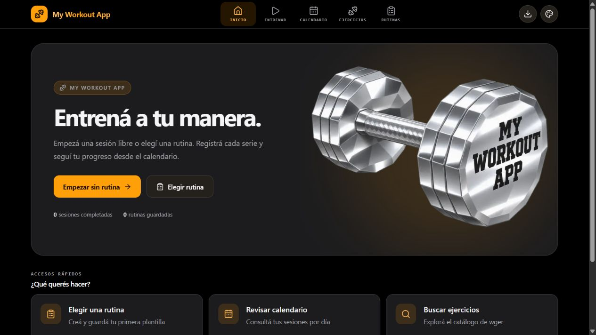

# Axel Quintana · Portfolio

**Desarrollador fullstack · Córdoba, Argentina**

Mi espacio para presentar lo que construyo: aplicaciones web, las tecnologías que utilizo y las decisiones detrás de cada proyecto. Este portfolio reúne una presentación personal, una selección de trabajos y formas de contactarme.

[GitHub](https://github.com/Leracius) · [LinkedIn](https://www.linkedin.com/in/axel-quintana/) · [Correo](mailto:lucasaxelqg15@gmail.com)

## Qué vas a encontrar

- **Presentación:** mi perfil y enfoque como desarrollador.
- **Proyectos:** capturas reales, funcionalidades, tecnologías y enlaces a la aplicación y al código.
- **Sobre mí:** herramientas con las que trabajo en frontend y backend.
- **Contacto:** acceso directo a correo, LinkedIn y WhatsApp.

La interfaz tiene un diseño adaptable a escritorio y móvil, navegación por secciones, menú móvil, foco visible para teclado y soporte para la preferencia de movimiento reducido.

## Proyecto destacado

### My Workout App

Aplicación web para registrar entrenamientos de fuerza, crear rutinas y consultar sesiones desde un calendario. Incluye registro de series, pesos y repeticiones, temporizador de descanso y bibliotecas de ejercicios. Los datos de entrenamiento se guardan localmente en el navegador.



**Tecnologías del proyecto:** Next.js · React · TypeScript · Tailwind CSS · PWA

[Probar My Workout App](https://mygymapp-chi.vercel.app/) · [Ver repositorio](https://github.com/Leracius/GYM-APP)

## Tecnologías del portfolio

Este repositorio utiliza **React**, **Vite** y **CSS**, con componentes escritos en JavaScript. El contenido de los proyectos está separado en un archivo JSON para facilitar su actualización.

Es un sitio estático: no requiere una base de datos ni variables de entorno. El contacto por correo abre el cliente de correo del visitante.

## Ejecutar localmente

Necesitás Node.js con npm y Git.

```bash
git clone https://github.com/Leracius/Portfolio-web.git
cd Portfolio-web
npm ci
npm run dev
```

Abrí la dirección local que indique Vite en la terminal.

| Comando | Función |
| --- | --- |
| `npm run dev` | Inicia el servidor de desarrollo. |
| `npm start` | Alternativa al servidor de desarrollo. |
| `npm run build` | Genera la versión de producción en `dist/`. |
| `npm run preview` | Permite revisar localmente la compilación de producción. |

Para revisar la versión de producción:

```bash
npm run build
npm run preview
```

## Estructura principal

```text
Portfolio-web/
├── public/
│   ├── favicon.svg          # Identidad del portfolio
│   └── my-workout-app.png   # Captura del proyecto destacado
├── src/
│   ├── App.jsx              # Secciones, navegación y tarjetas de proyectos
│   ├── main.jsx             # Punto de entrada de React
│   └── styles/
│       ├── index.css        # Variables visuales y estilos globales
│       └── App.css          # Composición y diseño adaptable
├── projects.json            # Contenido del catálogo de proyectos
├── index.html               # Idioma, título y metadatos
└── vite.config.js           # Configuración de Vite
```

## Actualizar el contenido

- **Agregar o editar proyectos:** modificá `projects.json`. Cada entrada incluye `id`, `name`, `category`, `link`, `img`, `tools`, `desc` y `details`. En `link`, la primera URL corresponde al repositorio y la segunda a la aplicación. Usá un `id` único.
- **Cambiar capturas:** guardalas en `public/` y referencialas desde el JSON, por ejemplo, `/mi-proyecto.png`. Si una imagen no carga, la tarjeta muestra el nombre del proyecto.
- **Editar la presentación y los contactos:** modificá `src/App.jsx`.
- **Ajustar colores, tipografía y distribución:** editá los archivos de `src/styles/`.
- **Actualizar la información para buscadores y redes:** modificá los metadatos de `index.html`.

Las fuentes se cargan desde Google Fonts, con fuentes de respaldo del sistema.

## Publicación

La carpeta `dist/`, generada con `npm run build`, puede alojarse en un servicio de hosting estático. La configuración habitual es:

- **Comando de compilación:** `npm run build`
- **Directorio de salida:** `dist`

## Contacto

¿Tenés un proyecto en mente o una oportunidad para conversar?

- [LinkedIn · Axel Quintana](https://www.linkedin.com/in/axel-quintana/)
- [Correo · lucasaxelqg15@gmail.com](mailto:lucasaxelqg15@gmail.com)
- [GitHub · Leracius](https://github.com/Leracius)
